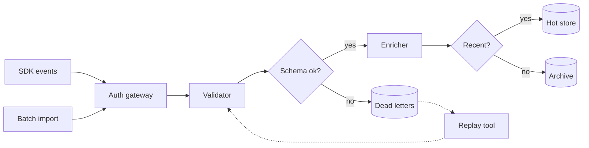

# Ingest Pipeline

A sample design note for a small event-ingest service. It exists to show how
rmdv renders a dense diagram, a display equation, and a deep heading tree.

## Overview

Events arrive from two sources, pass through validation and enrichment, and
land in either the hot store or the archive. The diagram below shows every
stage and the retry paths between them.

## Architecture

## Capacity Model

The Router sizes the hot store from the arrival rate, the service rate, and
the retention window. For a batch of n events with sizes s, a target fill
ratio ρ, and arrival rate λ, the required capacity C is:

$$
C = \frac{1}{\rho}\sum_{i=1}^{n} s_i \left(1 + \frac{\sigma_i^2}{\mu_i^2}\right)
$$

The fill ratio is the arrival rate divided by the service rate:

$$
\rho = \frac{\lambda}{\mu}
$$

The queueing delay at the Validator follows the M/M/1 form:

$$
W = \frac{1}{\mu - \lambda}
$$

## Failure Handling

### Retry Policy

Failed events return to the Validator with exponential backoff. After five
attempts they stay in the dead letter queue.

### Replay

The replay tool reads the dead letter queue and re-sends events in order.

## Rollout Plan

### Phase One

Run the new pipeline in shadow mode beside the old one.

### Phase Two

Switch the Web SDK first, then Mobile, then Batch import.
