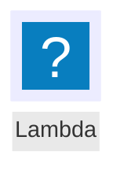

# Mermaid.js / Pele comparison

Two live browser renderers: official `mermaid@12.2.0` and `pele@1.9.0`.
The previous Rust output remains available as a collapsible, fixed reference.
This standalone prototype does not replace rmdv's desktop renderer.
All runtime packages and the AWS icon pack are served locally after setup.

## Run

From the repository root:

```sh
cargo run --locked --example renderer_compare -- prototypes/mermaid-js/reference
cd prototypes/mermaid-js
npm ci
npm run prepare:icons
npm start
```

Open <http://127.0.0.1:4317>. Stop with Ctrl+C in the server terminal.
Set `MERMAID_TRIAL_PORT` to choose another loopback-only port.

The reference exporter uses rmdv's actual Markdown parser and SVG/RGBA worker
against `tests/fixtures/renderer_trial.md`. Generated references, the downloaded
icon cache, screenshots, and test exports are ignored by Git.

## Compare

- Both main panels render source edits. Press Render or Cmd/Ctrl+Enter.
  Invalid input and renderer failures are reported independently.
- Switch appearance and palette. Pele uses CSS variables, not Mermaid's
  `themeVariables`; the UI calls this out for init-theme examples. The dark
  Pele palette is supplied by this prototype; the light palette uses Pele's
  documented defaults. The rmdv option uses exported Rust palette values.
- The Dagre/ELK control applies to Mermaid only. Pele uses its own layout and
  preserves source direction (`autoDirection: false`).
- Zoom and SVG export work for both engines. Select the exported engine next
  to Download SVG. Pele's theme variables are frozen into the SVG so it keeps
  the selected colors outside this page.
- The Rust reference always shows the original source, never the edited one.
  Newly added AWS samples have no native reference; the page says so instead
  of displaying a stale image.

Mermaid 12.2.0 ELK fails on the supplied mindmap with a null `re` error. Dagre
succeeds and is the initial setting. Pele still displays its result when the
Mermaid side fails; no renderer is substituted silently.

## AWS icons

Choose **AWS 圖示流程圖** or **AWS 架構圖**. Both demonstrate API Gateway,
Lambda, and DynamoDB using original multicolor vector artwork.

The checksum-pinned AWS Labs pack contains 871 icons. The same icon data is
registered with `mermaid.registerIconPacks()` and supplied to Pele's `icons`
resolver. The `aws:` prefix supports canonical AWS Labs names (for example,
`aws:lambda`) and 279 `arch-*` aliases derived from source artwork identifiers
(for example, `aws:arch-aws-lambda`). This is not a promise that every name in
Mermaid Chart's independently maintained AWS catalog is present.

Expand **AWS 圖示名稱** and search to see available identifiers. Unknown names
report a clear error instead of quietly producing a placeholder. A flowchart
node uses current Mermaid icon syntax:



See `THIRD_PARTY_NOTICES.md` and `AWS-ICONS-LICENSE.txt` for the icon source,
fixed revision, checksum, and attribution. These assets retain their own
license independently of the surrounding application code.

## Verify

`npm run test:icons` runs deterministic, browser-free pack/alias and Pele SVG
checks. `npm test` runs the reproducible browser harness using an installed
Google Chrome, a separate profile, and a temporary server on 127.0.0.1:4318.
Screenshots and an exported SVG are saved under `artifacts/`.

The extension was also exercised in the app browser: nine samples in both
appearances, AWS vector artwork in each engine, rmdv palette mapping, unknown
icons, isolated ELK errors, per-engine export availability, and recovery.
A downloaded Pele AWS SVG was parsed to confirm vector paths and embedded
palette variables. The updated browser harness is provided for reproduction;
the original 26-check headless run predates the Pele/AWS extension.

## Integration boundary

This proves local browser rendering, not resvg compatibility or Iced WebView
embedding. Mermaid SVG can contain HTML labels; Pele SVG uses CSS variables
and trusted icon markup. Future desktop work must retain working AWS icon
registration/resolution, local assets, errors for missing icons, and exported
artwork before an engine is selected. Packaging, startup, platform support,
and native integration require separate evaluation.
